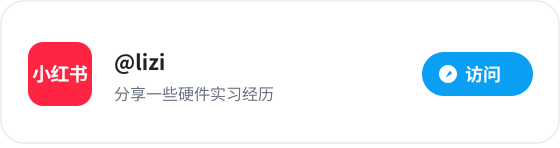
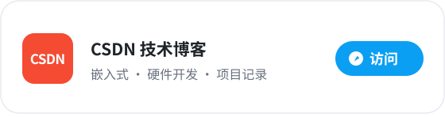

# Hi, I'm lizi 👋

> Chengdu,Sichuan. Undergraduate students of 2023
> Embedded Systems / Hardware Engineering / Edge AI

## 🧰 Tech stack

**Languages & Tools**

**Embedded & Hardware**

---

## 📫 Contact

- Email: **liziyaaa@outlook.com**

**Elsewhere on the web**

  
  

---
> Stay hungry. Stay foolish.
> Keep building. Keep debugging. Keep things measurable.
